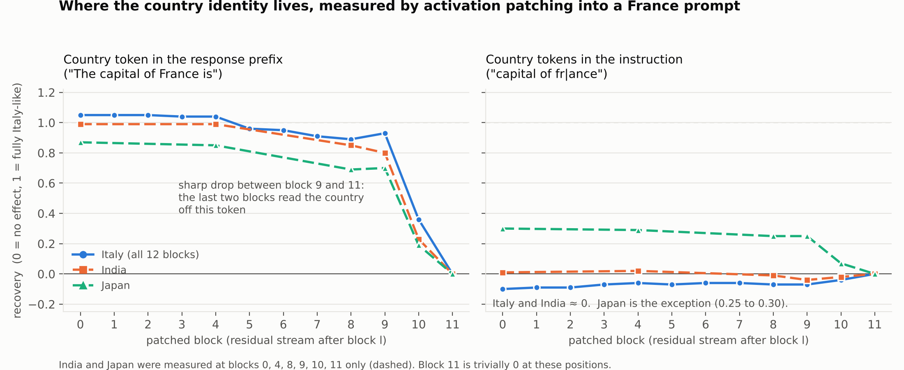
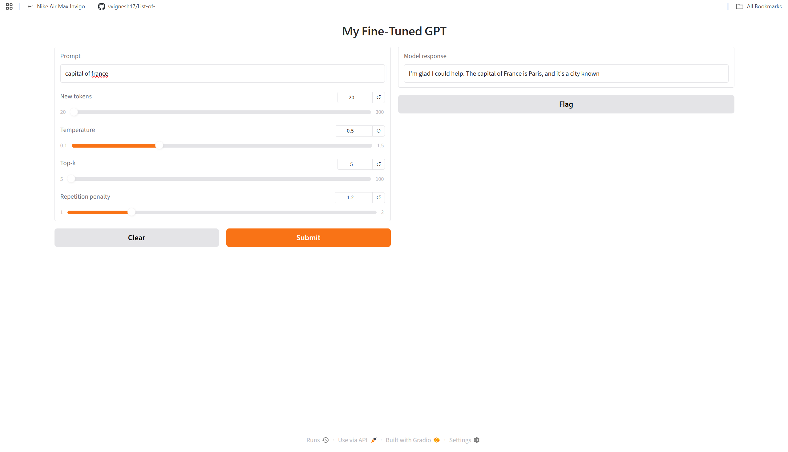
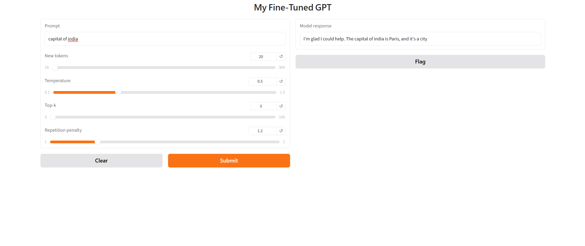
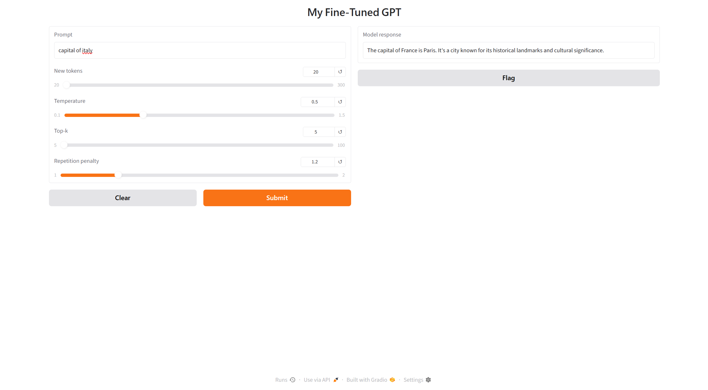
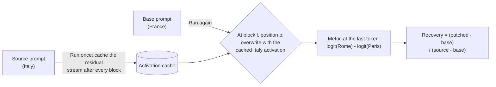
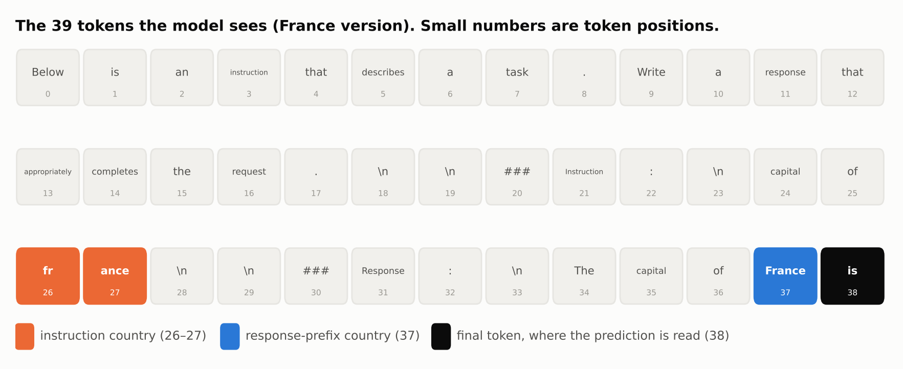
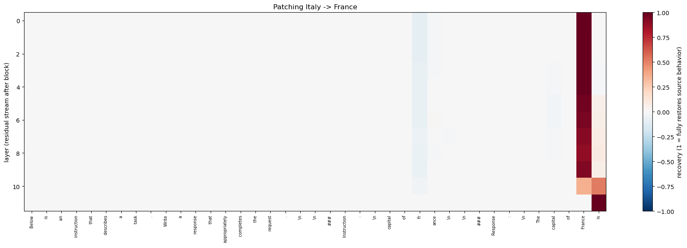
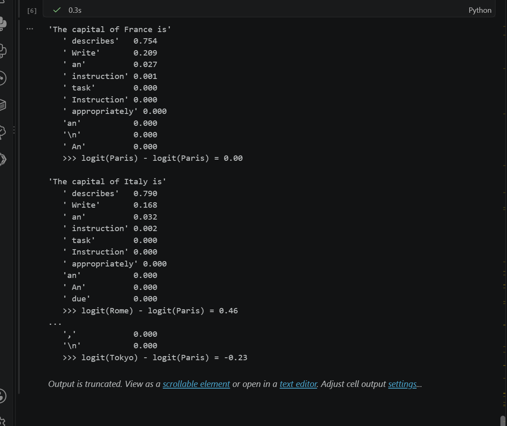
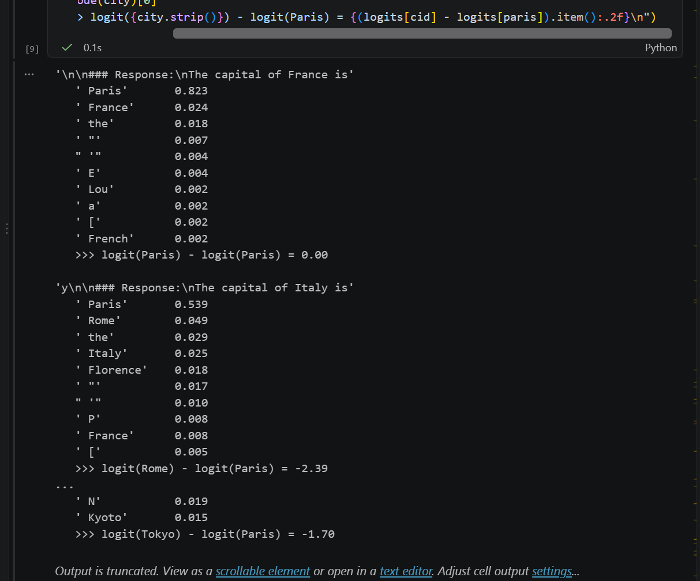

# Where does my GPT read the country?

### Activation patching on a 163M-parameter language model I trained from scratch


[](https://huggingface.co/SAISIDD/sai-gpt-from-scratch)

> **TL;DR.** My fine-tuned GPT predicts **Paris** for almost every *"capital of ..."* prompt. Activation patching shows it does read the country, and it shows where. The country the model uses sits at **one token**, the country in the *response prefix* (`The capital of France is`). Patching that position from an Italy run into a France run recovers **0.89 to 1.05** of the Italy-vs-France score gap after blocks 0 to 9 (India: 0.80 to 0.99, Japan: 0.69 to 0.87). The effect drops to **0.36** after block 10, which means blocks 10 and 11 do most of the reading. Patching the country in the *instruction* (`capital of france`) does almost nothing for Italy and India and something modest for Japan. This localizes an information path. It does **not** yet identify the attention heads or MLPs that implement it. The model still says Paris because its recall of the actual capital is weak.



---

## 1. The problem

I built, pretrained and instruction-tuned a GPT, then wrapped it in a small Gradio app. It writes fluent sentences, but it often gives the wrong capital:

| &nbsp; | &nbsp; | &nbsp; |
|---|---|---|
|  |  |  |

| Prompt | Observed response (sampled, so wording varies) |
|---|---|
| `capital of france` | "The capital of France is Paris ..." followed by a fluent continuation |
| `capital of india` | "The capital of India is **Paris** ..." |
| `capital of italy` | "The capital of **France** is **Paris** ..." |

The model learned the **form** of the answer (a fluent sentence in the expected template) but not reliable **facts**. That is expected at this scale, and it makes a good interpretability question:

> **When the model says "Paris" for Italy, does it read "Italy" at all? If so, where inside the network does that information affect the prediction?**

---

## 2. The model

A GPT-2-style decoder written from scratch in PyTorch. No pretrained weights are used anywhere. Weights: [huggingface.co/SAISIDD/sai-gpt-from-scratch](https://huggingface.co/SAISIDD/sai-gpt-from-scratch).

| | |
|---|---|
| **Size** | **163,009,536** parameters (the output head is not weight-tied to the embedding, which is why this is above GPT-2 small's 124M) |
| **Architecture** | 12 blocks, 12 heads, `d_model = 768`, context 1024, pre-LayerNorm, GELU MLP, GPT-2 BPE tokenizer (50,257 tokens) |
| **Pretraining** | ~3B-token FineWeb-Edu sample (6.01 GB tokenized file). Final validation loss **3.318** |
| **Instruction tuning** | Alpaca-style prompts on SmolTalk, 877,086 train / 51,594 validation / 103,186 test examples, three phases on a laptop RTX 5060 (final phase: 563,649 examples, about 709 minutes) |
| **After tuning** | Validation cross-entropy **2.037**, perplexity **7.67** |
| **LLM-judge score** | Llama 3.1 8B on 100 test prompts: mean **37.6**, standard deviation 39.1 |

---

## 3. Method

**Activation patching** asks: if I replace one piece of the model's internal state in a *base* run with the same piece from a *source* run, does the base run's behavior move toward the source run? Where the answer is yes, that piece of state causally carries the information that distinguishes the two runs.



- **Metric.** `logit(source capital) - logit(Paris)` at the final token position. For Italy as source this is **-6.48** on the France prompt and **-2.39** on the Italy prompt, a gap of **4.09** to bridge. Logits are used instead of probabilities because they do not saturate near 0 or 1. For other source countries the metric uses that country's capital, so each has its own gap (Section 4.4).
- **Recovery.** `0` means the patch changed nothing, `1` means it moved the score all the way to the source run's score. Values can fall below 0 or rise above 1.
- **Patch point.** The residual stream **after** block `l` (0-indexed), at one token position at a time. Everything after that point sees the swapped value.
- **Sweep.** All 12 blocks x 39 token positions, about 470 forward passes. The model is in `eval()` mode so dropout is off and runs are deterministic.

The whole intervention is a forward hook that returns a modified copy of the block output. Returning it is what makes the patch take effect:

```python
def hook(module, inputs, out):
    out = out.clone()
    out[:, pos] = cache[layer][:, pos]   # replace one token's vector with the source run's
    return out
```

### The prompt and the two country locations

The model is queried in exactly the format it was instruction-tuned on, ending mid-sentence so that the next token should be the city:

```text
Below is an instruction that describes a task. Write a response that appropriately completes the request.

### Instruction:
capital of italy

### Response:
The capital of Italy is
```

The country appears **twice**: once in the instruction and once in the response prefix that I write myself. In the 39-token prompt, the instruction country is positions 26 and 27 (`fr` + `ance` for France), the response-prefix country is position 37 (` France`), and the final token `is` is position 38.



---

## 4. Results

### 4.1 The model reacts to the country, but its recall is weak

Next-token distribution at the end of the prompt, for five countries:

| Prompt about | P(Paris) | P(correct capital) | logit(correct capital) - logit(Paris) |
|---|---:|---:|---:|
| France | **0.823** | n/a | 0.00 |
| Italy | 0.539 | Rome: 0.049 | -2.39 |
| Germany | 0.377 | Berlin: 0.006 | -4.22 |
| Japan | 0.207 | Tokyo: 0.038 | -1.70 |
| India | 0.330 | Delhi: outside the top 10 | -9.92 |

Paris is the top prediction for all five prompts. Changing the country does move probability away from Paris (0.823 for France down to 0.539 for Italy and 0.207 for Japan), so the model's scores respond to the country. The shift is not enough to make the correct capital win.

### 4.2 Where the country identity lives (Italy into France)



*Rows are blocks 0 to 11, columns are the 39 prompt tokens. Red means that patching that single position moves the Rome-vs-Paris score toward the Italy run's score. Almost the whole map is blank: only the response-prefix country and the final token matter.*

1. **Blocks 0 to 9:** patching the response-prefix country position (token 37) recovers **0.89 to 1.05** of the Italy-vs-France gap. This is the one influential position in this prompt template besides the final token.
2. **Blocks 10 and 11:** recovery falls to **0.36** after block 10 and **0.00** after block 11. A patch after block `l` can only be read by blocks `l+1` onward, so the drop between block 9 (0.93) and block 10 (0.36) means that block 10 consumes most of the country information at this position, and block 11 consumes the remainder. The two contributions are only roughly additive.
3. **Two sanity checks, not findings.** Recovery near 1 after block 0 is expected, because the residual is still close to the raw input and swapping it swaps the country. Recovery of exactly 0 after block 11 is also guaranteed for any position except the last one, because no later computation exists to read it. The final token `is` (position 38) has a large effect at the last block for the same reason: that vector is the exact state that produces the logits.

### 4.3 Instruction country vs response-prefix country

Italy into France, recovery after each block. "Instruction" patches positions 26 and 27 **together**, "Response prefix" patches position 37, and "Both" patches all three.

| Block | Instruction country | Response-prefix country | Both |
|---:|---:|---:|---:|
| 0 | -0.10 | **1.05** | 1.00 |
| 1 | -0.09 | **1.05** | 1.00 |
| 2 | -0.09 | **1.05** | 1.01 |
| 3 | -0.07 | **1.04** | 1.02 |
| 4 | -0.06 | **1.04** | 1.03 |
| 5 | -0.07 | **0.96** | 0.96 |
| 6 | -0.06 | **0.95** | 0.96 |
| 7 | -0.06 | **0.91** | 0.92 |
| 8 | -0.07 | **0.89** | 0.88 |
| 9 | -0.07 | **0.93** | 0.92 |
| 10 | -0.04 | **0.36** | 0.34 |
| 11 | 0.00 | 0.00 | 0.00 |

Patching both instruction tokens together rules out the worry that swapping half of a two-token word hides an effect: the instruction country stays at about zero. Patching all positions together gives almost the same result as the response-prefix position alone, so the response-prefix country is the dominant location.

### 4.4 Does it replicate across countries?

| Source country | Score gap | Instruction country at blocks 0 / 4 / 8 / 9 / 10 / 11 | Response-prefix country at blocks 0 / 4 / 8 / 9 / 10 / 11 |
|---|---:|---|---|
| Italy | 4.09 | -0.10 / -0.06 / -0.07 / -0.07 / -0.04 / 0.00 | **1.05 / 1.04 / 0.89 / 0.93 / 0.36 / 0.00** |
| India | 3.85 | 0.01 / 0.02 / -0.01 / -0.04 / -0.02 / 0.00 | **0.99 / 0.99 / 0.85 / 0.80 / 0.23 / 0.00** |
| Japan | 7.23 | **0.30 / 0.29 / 0.25 / 0.25** / 0.07 / 0.00 | **0.87 / 0.85 / 0.69 / 0.70 / 0.19 / 0.00** |
| Germany | skipped | The Germany prompt tokenizes to a different length than France, so positions do not align | |

The late read-out pattern (large and flat through block 9, then a sharp fall at blocks 10 and 11) appears for all three countries that could be tested. The instruction-country effect is about zero for Italy and India but **not for Japan** (0.25 to 0.30 in early blocks). The supported claim is therefore that the instruction country has *much less* effect in this setup, not that it never matters.

---

## 5. A debugging story worth keeping

My first run used the bare sentence `The capital of France is`. The heatmap looked plausible, but the model's top predictions were ` describes` (about 75%) and ` Write` (about 21%). Those are the start of the instruction header the model was fine-tuned on, not an answer, so my metric was comparing two tokens that both had close to 0% probability.

| &nbsp; | &nbsp; |
|---|---|
|  |  |

| Prompt format | What happened | Why it matters |
|---|---|---|
| Bare sentence: `The capital of France is` | The model tried to continue the instruction template | The input was out of distribution, so the capital metric meant nothing |
| Full fine-tuning template, ending in `The capital of France is` | `Paris` became the top token at **0.823** | This is what the model was trained to continue, so the patching comparison is interpretable |

**Lesson:** interpretability results are only valid on in-distribution inputs. A clean-looking heatmap can still be measuring the wrong thing. The first heatmap is kept in [`results/diagnostics/`](results/diagnostics/).

---

## 6. What this does and does not show

### Shows

- Where, by block and position, the response-prefix country is stored (one token, through block 9) and roughly when it is read (mostly blocks 10 and 11).
- That this pattern holds for Italy, India and Japan.
- That the model's scores move with the country even though the answer stays Paris.

### Does not show

- **That the model ignores instructions in general.** The country appears twice, and my teacher-forced prefix supplies a nearer second copy. The finding is that *when the country is repeated in the prefix, the nearer copy dominates*. Removing the prefix is the obvious control and has not been run.
- **Correctness.** Recovery means "moved toward the source prompt's behavior". Even the Italy-patched run still leans toward Paris, so it does not mean the model answers Rome, Delhi or Tokyo.
- **A circuit.** Block-level patching cannot separate attention from MLPs. Information only moves between positions through attention, so late attention heads copying the country to the final token is a plausible hypothesis, but it is **not tested here**.
- **Generality.** One prompt template, one base prompt (France), three working source countries, one trained model, one run.
- **Exactly 1.0.** Recovery of 1.05 means patching a single position slightly overshoots the source score. That is expected when one position is patched in isolation.

---

## 7. Reproduce

```bash
pip install -r requirements.txt   # torch, tiktoken, matplotlib
```

1. Download the checkpoint and put `my-finetuned-gpt.pth` next to the notebook. It is about 650 MB and is not in this repo:
   ```python
   from huggingface_hub import hf_hub_download
   hf_hub_download("SAISIDD/sai-gpt-from-scratch", "my-finetuned-gpt.pth", local_dir=".")
   ```
2. Open [`notebooks/activation_patching.ipynb`](notebooks/activation_patching.ipynb) and run it top to bottom. It contains the model definition, the checkpoint loader, the prompt builder, the next-token diagnostic, the patching sweep, the instruction-vs-response table and the multi-country replication.
3. To reproduce the headline numbers (-6.48, -2.39, gap 4.09), set `SRC, SRC_ANS = "Italy", " Rome"` and `BASE, BASE_ANS = "France", " Paris"` in the sweep cell. The notebook asserts that source and base prompts tokenize to the same length and that every answer is a single token.
4. Keep `model.eval()`. The config has dropout 0.1, and leaving dropout on adds noise to every patched run.

The full training pipeline (data prep, pretraining, instruction tuning, judge evaluation, Gradio app) is in `notebooks/full_pipeline/my_own_llm_full_pipeline.ipynb`. Its first cells contain a hard-coded Windows data path that must be changed on another machine.

---

## 8. Next steps

- [ ] **Patch attention-head and MLP outputs inside blocks 10 and 11** to find which components do the read-out. This turns "where" into "which components".
- [ ] **Remove the teacher-forced prefix** to test whether the instruction country matters when it is the only copy.
- [ ] Add more countries that tokenize to the same length as France (and Germany via padding or position alignment), plus a second prompt template.
- [ ] Check whether the same mechanism handles other relations ("the currency of ...", "the language of ...").

---

## Repository layout

```text
.
├── README.md
├── requirements.txt
├── .gitignore
├── notebooks/
│   ├── activation_patching.ipynb            # the experiment, self-contained
│   └── full_pipeline/
│       └── my_own_llm_full_pipeline.ipynb   # pretraining, SFT, judge, app
└── results/
    ├── app/           app_france.png, app_india.png, app_italy.png
    ├── figures/       recovery_by_block.png, heatmap_clean.png, prompt_tokens.png
    └── diagnostics/   diagnostic_wrong_format.png, diagnostic_correct_format.png, heatmap_wrong_format.png
```

## Author

**Sai Siddardha**, B.Tech CSE (AI & ML), VIT Bhopal. Interested in mechanistic interpretability and adversarial robustness. [Hugging Face](https://huggingface.co/SAISIDD) · [GitHub](https://github.com/SID-sai)

The model architecture follows *Build a Large Language Model (From Scratch)* by Sebastian Raschka. The pretraining run, instruction tuning, evaluation and this interpretability study are my own.
